# Craft Pi Server

Servidor de Minecraft para tu casa en una **Raspberry Pi 5 de 4 GB**: un solo mundo para jugadores **Java y Bedrock**, un **panel web** con estilo Minecraft para administrarlo desde el móvil o el ordenador, y un mapa 3D en vivo. Todo queda en tu red local: no se abren puertos del router.

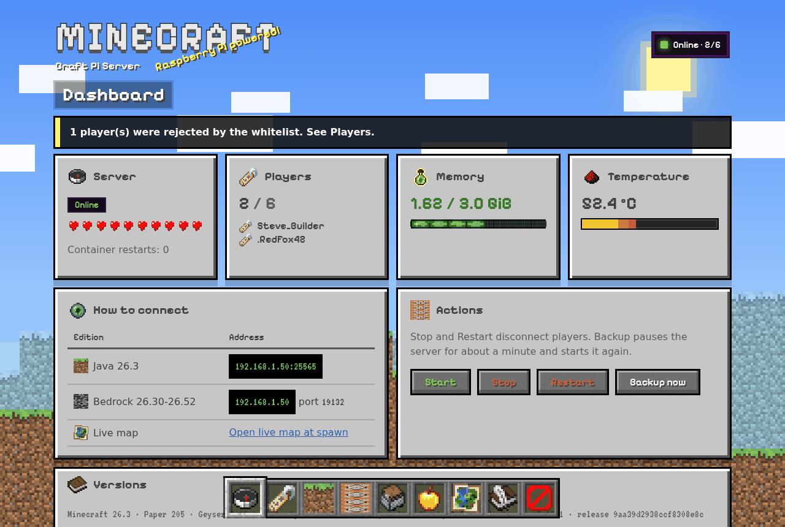

- **Java y Bedrock en el mismo mundo**: Paper + Geyser + Floodgate, listo para NetherNet (Bedrock 26.60+). Con ViaVersion también entran clientes Java de otras versiones, por ejemplo QuestCraft en Meta Quest.
- **Panel web**: estado en vivo, whitelist, perfiles de jugador con inventario y estadísticas, acciones (dar objetos, kits, efectos, teletransporte, mensajes…), consola, backups, auditoría y una biblioteca de hasta 50 mundos.
- **Skins de Bedrock completas**, también las del creador de personajes, gracias al addon propio MclanSkins.
- **Mapa BlueMap** en `http://IP_DE_LA_PI:8100/`.
- **Operación segura**: versiones fijadas por SHA-256, backups verificados archivo por archivo, actualizaciones con snapshot previo y vuelta atrás, RCON nunca publicado y panel sin privilegios.

> Las capturas usan datos de demostración. Las texturas y el logo de Minecraft no están en este repositorio: el panel los extrae en tu Pi del cliente oficial que descarga BlueMap.

## Índice

1. [Estado del proyecto](#1-estado-del-proyecto)
2. [Requisitos](#2-requisitos)
3. [Instalación completa, paso a paso](#3-instalación-completa-paso-a-paso)
4. [Conectarse a jugar](#4-conectarse-a-jugar)
5. [El panel web](#5-el-panel-web)
6. [Mapa BlueMap](#6-mapa-bluemap)
7. [Biblioteca de mundos](#7-biblioteca-de-mundos)
8. [Skins de Bedrock (MclanSkins)](#8-skins-de-bedrock-mclanskins)
9. [Administración desde la terminal](#9-administración-desde-la-terminal)
10. [Backups y restauración](#10-backups-y-restauración)
11. [Actualizar](#11-actualizar)
12. [Configuración y memoria](#12-configuración-y-memoria)
13. [Red y arranque automático](#13-red-y-arranque-automático)
14. [Diagnóstico](#14-diagnóstico)
15. [Arquitectura, archivos y desarrollo](#15-arquitectura-archivos-y-desarrollo)
16. [Fuentes y licencias](#16-fuentes-y-licencias)

## 1. Estado del proyecto

El proyecto está instalado y en uso en una Raspberry Pi 5 de 4 GB con Raspberry Pi OS de 64 bits. [docs/ESTADO.md](docs/ESTADO.md) separa lo **implementado** de lo **verificado en hardware**, fase a fase; [docs/VALIDACION.md](docs/VALIDACION.md) detalla las pruebas.

El instalador sólo da por buena una instalación tras comprobar desde la propia Pi:

- Contenedor estable y `healthy`.
- Java (Server List Ping por TCP) y Bedrock (RakNet por UDP), también a través de los puertos publicados en la IP LAN.
- Signaling NetherNet de Geyser iniciado y su puerto TCP aceptando conexiones.
- Mediante un diagnóstico offline de la instancia cargada:
  - Geyser y Floodgate habilitados, igual que cada plugin de la release (BlueMap, Chunky, ViaVersion, ViaBackwards, MclanSkins) salvo los que hayas desactivado;
  - protocolo Java real de Paper igual al de la build de Geyser;
  - autenticación Floodgate con `online-mode=true`.

Eso prueba servicios y red, no el inicio de sesión ni el rendimiento. La prueba final es entrar y jugar desde un Java y un Bedrock reales de tu LAN.

**Fuera de alcance:** publicar el servidor en Internet, mods de Forge o Fabric y varias instalaciones en el mismo equipo.

## 2. Requisitos

| Elemento | Requisito |
| --- | --- |
| Equipo | Raspberry Pi 5 de 4 GB, alimentación oficial y refrigeración activa |
| Sistema | Raspberry Pi OS de 64 bits (Debian 12 Bookworm o 13 Trixie). Se recomienda la versión **Lite**: con escritorio quedan menos de 2 GiB libres |
| Almacenamiento | microSD de 128 GB recomendada; mínimo 8 GiB libres para el proyecto y 4 GiB para Docker |
| Red | LAN, preferiblemente por cable, y salida a Internet para instalar, descargar versiones y autenticar a los jugadores |
| Software | Python 3.11 o posterior (viene con el sistema). El instalador añade Docker si falta |
| Clientes | Java de la versión que fije el instalador (o de otra, gracias a ViaVersion); Bedrock dentro del rango que admita Geyser |

Una tarjeta «de 128 GB» no muestra 128 GiB en Linux: el instalador comprueba el espacio realmente disponible. Los backups ocupan aproximadamente lo mismo que el mundo cada uno.

## 3. Instalación completa, paso a paso

Si empiezas con una microSD vacía, la [guía desde cero](docs/INSTALACION_DESDE_CERO.md) explica cómo grabar el sistema, entrar por SSH y hacer las pruebas de persistencia y backup. Los comandos siguientes se ejecutan **en la Pi**.

| Paso | Qué haces | Tiempo aproximado |
| --- | --- | --- |
| 1 | Ajustes recomendados del sistema y reinicio | 5 min |
| 2 | Descargar el proyecto | 1 min |
| 3 | Instalar el servidor | 10–20 min |
| 4 | Instalar el panel web | 2–10 min |
| 5 | Primer acceso: contraseña, whitelist y operador | 5 min |
| 6 | Opcional: pregenerar el mundo y fijar su borde | ~25 min |
| 7 | Auditoría y prueba de juego | 10 min |

### 3.1 Ajustes recomendados del sistema

Raspberry Pi OS arranca con el cgroup de memoria desactivado. Sin él, Docker ignora el límite de 3 GiB del contenedor. Actívalo **antes de instalar**: si lo haces después, habrá que recrear el contenedor una vez (ver [§12](#12-configuración-y-memoria)).

```bash
sudo cp /boot/firmware/cmdline.txt /boot/firmware/cmdline.txt.bak     # copia del original
grep -q cgroup_enable=memory /boot/firmware/cmdline.txt || \
  sudo sed -i '1 s/$/ cgroup_enable=memory/' /boot/firmware/cmdline.txt  # al final de su única línea
sudo systemctl set-default multi-user.target                           # opcional: arrancar sin escritorio
sudo reboot
```

Tras el reinicio, `grep -w memory /sys/fs/cgroup/cgroup.controllers` debe mostrar `memory`. Para deshacerlo, restaura `cmdline.txt.bak`; para volver al escritorio, `sudo systemctl set-default graphical.target`.

### 3.2 Descargar el proyecto

```bash
sudo apt-get update
sudo apt-get install -y git python3 ca-certificates iproute2
sudo git clone https://github.com/Vgarcan/Craft_Pi_server.git /opt/minecraft-lan-installer
cd /opt/minecraft-lan-installer
```

El proyecto debe estar en una carpeta de root, como `/opt/minecraft-lan-installer`, y descargarse con `sudo`. El panel ejecuta su helper con una regla sudo y exige que todo su código pertenezca a root.

**Sin Git:** descarga el [ZIP de la rama main](https://github.com/Vgarcan/Craft_Pi_server/archive/refs/heads/main.zip) y comprueba su contenido:

```bash
sudo apt-get install -y curl unzip
curl --fail --location --output /tmp/Craft_Pi_server-main.zip https://github.com/Vgarcan/Craft_Pi_server/archive/refs/heads/main.zip
sudo unzip /tmp/Craft_Pi_server-main.zip -d /opt
sudo mv /opt/Craft_Pi_server-main /opt/minecraft-lan-installer
cd /opt/minecraft-lan-installer
sudo chmod +x install.sh manage.sh panel/install.sh tools/audit.sh tests/run.sh docker/*.sh
sha256sum -c --quiet MANIFEST.sha256 && echo 'Archivos íntegros'
```

`MANIFEST.sha256` lista el SHA-256 de cada archivo del repositorio. No descomprimas encima de una instalación existente: la carpeta de destino debe ser nueva.

### 3.3 Instalar el servidor

Primero comprueba el sistema sin instalar nada. Si la Pi tiene varias direcciones, indica la que usarán los jugadores:

```bash
sudo ./install.sh --check --lan-ip 192.168.1.50
```

Lee la [EULA de Minecraft](https://www.minecraft.net/eula). Si la aceptas:

```bash
sudo ./install.sh --accept-eula --lan-ip 192.168.1.50 --contact https://github.com/TU_USUARIO
```

- **Sustituye `192.168.1.50` por la IP real de la Pi** (`ip -4 addr`). Si sólo hay una candidata, puedes omitir `--lan-ip`.
- `--contact`, una URL o un email, va en el `User-Agent` que exige la API de Paper.
- `--disable-plugin mclan_skins` o `--disable-plugin bluemap` (se puede repetir) instala con ese plugin opcional desactivado. Sirve, por ejemplo, si MclanSkins no compilara con una versión nueva de Geyser.

La instalación:
1. Elige la versión de Minecraft que soporta Geyser y el build estable de Paper correspondiente.
2. Fija Geyser, Floodgate, BlueMap, Chunky, ViaVersion y ViaBackwards por SHA-256.
3. Instala Docker si falta y construye la imagen.
4. Compila MclanSkins en un contenedor sin red.
5. Genera el mundo, arranca y verifica.

No apagues la Pi mientras trabaja. El primer arranque admite 900 s (`--timeout` hasta 7200).

### 3.4 Instalar el panel web

```bash
sudo panel/install.sh
```

Crea el usuario sin privilegios `mclan-panel`, un certificado autofirmado para la IP, la regla sudo limitada al helper y el servicio `mclan-panel`. También extrae del cliente de Minecraft las texturas y el catálogo de objetos.

En una instalación nueva BlueMap descarga ese cliente unos minutos después del primer arranque: el script **espera hasta 10 minutos** (para cambiarlo: `sudo MCLAN_ASSETS_WAIT=1200 panel/install.sh`). Si aun así no está, el panel funciona con su estilo CSS y basta con repetir `sudo panel/install.sh` más tarde.

Al terminar imprime la dirección (`https://IP_DE_LA_PI:8443/`) y la **huella SHA-256 del certificado**. Compárala con la que muestre el navegador antes de aceptar el aviso de certificado autofirmado.

### 3.5 Primer acceso, whitelist y operador

```bash
sudo cat /etc/mclan-panel/data/initial-password
```

1. Entra en el panel con esa contraseña y cámbiala en **Account**. Si la olvidas: `sudo panel/install.sh --reset-password`.
2. La whitelist está activa desde el principio (`white-list=true` y `enforce-whitelist=true`): nadie puede entrar hasta que lo añadas. En instalaciones anteriores a la 0.8.2, actívala en **Players → Turn whitelist on**; `tools/audit.sh` avisa si está apagada. En **Players → Add a player**:
   - **Java:** el nombre de la cuenta.
   - **Bedrock:** el gamertag sin espacios, o su XUID.
   - **Bedrock con «Floodgate does not know»:** pide al jugador que intente entrar una vez y usa **Open 5 min and wait** en su intento rechazado. La whitelist se abre hasta que entra, lo añade y se vuelve a cerrar.
3. Abre tu perfil (Players → tu nombre) y usa **Actions → Admin → Make operator** para tener permisos de operador en el juego.

Los jugadores Bedrock aparecen con un punto delante (`.Gamertag`): es el prefijo de Floodgate.

Desde la terminal también puedes hacerlo:

```bash
sudo ./manage.sh command "whitelist add NOMBRE_JAVA"
sudo ./manage.sh command "fwhitelist add GAMERTAG"
sudo ./manage.sh command "op NOMBRE"
```

### 3.6 Opcional: pregenerar el mundo y fijar su borde

Generar terreno mientras se juega causa tirones en la Pi, y el mapa queda incompleto. Con [Chunky](https://hangar.papermc.io/pop4959/Chunky), incluido en la release, puedes generar de antemano un cuadrado alrededor del spawn y poner ahí el borde del mundo. Desde **Console** en el panel:

```text
chunky spawn
chunky shape square
chunky radius 1600
chunky start
worldborder center SPAWN_X SPAWN_Z
worldborder set 3200
```

- **Centro del borde:** pon el mismo centro que Chunky, es decir, las coordenadas X y Z del spawn, que ves en el perfil de cualquier jugador (Teleport → World spawn).
- **Tamaño:** un radio de 1600 (3200 × 3200 bloques) tarda unos 25 minutos en la Pi 5 y ronda los 70 °C con refrigeración activa.
- **Progreso:** sigue en World o con `chunky progress`.
- **Para ampliar:** pregenera un radio mayor y sube el borde.

### 3.7 Auditoría y prueba de juego

```bash
sudo tools/audit.sh --verify
```

Revisa en modo lectura arranque, límite de memoria, contenedor, puertos (sólo en la IP LAN), NetherNet, cada plugin, MclanSkins, panel (servicio, regla sudo, texturas y catálogo), whitelist, recursos y backups. Termina con «sin fallos», o con un código de salida 1 si hay algún FALLO. La misma auditoría está en el panel, en **Health**.

Después conecta un Java y un Bedrock ([§4](#4-conectarse-a-jugar)). La [guía desde cero](docs/INSTALACION_DESDE_CERO.md) incluye una prueba de persistencia, reinicio y restauración que conviene hacer antes de tomarte el mundo en serio.

## 4. Conectarse a jugar

| Cliente | Cómo |
| --- | --- |
| **Java** (PC/Mac/Linux) | Multijugador → Añadir servidor → `IP_DE_LA_PI:25565`. Necesita una cuenta Java válida |
| **Java de otra versión** (QuestCraft, clientes antiguos) | Igual. ViaVersion y ViaBackwards traducen el protocolo desde la 1.10 hasta algo más nuevo que el servidor; el mundo no cambia de versión. Lo que no exista en tu versión se ve con un sustituto |
| **Bedrock** (móvil, Windows, tableta) | Jugar → Servidores → Añadir servidor → dirección `IP_DE_LA_PI`, puerto `19132`. Floodgate permite entrar sin cuenta Java |

- **Pestaña LAN:** no se garantiza que el servidor aparezca ahí, porque Docker usa una red bridge. Escribe la dirección a mano.
- **Wi-Fi de invitados:** suele aislar a los clientes entre sí y puede impedir la conexión.
- **Consolas:** algunas no permiten añadir servidores externos. Multiplataforma no garantiza conexión directa desde Xbox, PlayStation o Switch.
- **Internet:** Geyser necesita salida a Internet al arrancar para autenticar a los jugadores Bedrock.

**NetherNet.** Bedrock deja RakNet desde la 26.60. Geyser funciona con `transport: both`:
- RakNet sigue en UDP 19132.
- NetherNet usa signaling HTTP en TCP 19132 y WebRTC en UDP 19133.

Los jugadores siguen usando la misma dirección y el puerto 19132. Sobre la configuración:
- Los valores van en `compose.yaml` como propiedades JVM, que prevalecen sobre `config.yml`. La dirección anunciada es la IP LAN; `rebind` la actualiza.
- La identidad NetherNet del servidor (`data/plugins/Geyser-Spigot/nethernet/`) va en los backups.
- El signaling usa HTTP sin TLS: la primera vez el cliente pide confirmar el servidor.
- **Pendiente:** probar con un cliente 26.60 real cuando exista (`manage.sh update --plan`).

## 5. El panel web

`https://IP_DE_LA_PI:8443/`, sólo en tu LAN. Está en inglés y se maneja como el juego: la barra de objetos de abajo es el menú (teclas 1–9 o la rueda del ratón sobre ella). Funciona sin JavaScript, salvo la subida de mundos desde el navegador; con él, navega sin recargar y avisa de lo que pasa.

| Página (tecla) | Qué permite |
| --- | --- |
| Dashboard (1) | Estado y salud, jugadores conectados, memoria y temperatura en vivo, direcciones para conectarse (clic para copiar), arrancar, parar, reiniciar, backup y versiones |
| Players (2) | Jugadores conocidos y sus perfiles; whitelist (activar, añadir Java, Bedrock o XUID, quitar); intentos rechazados de las últimas 72 h con **Allow** y **Open 5 min and wait**; apertura temporal para un jugador (Java o Bedrock, de 1 a 15 minutos) |
| World (3) | Biblioteca de mundos, subir mundos, BlueMap (pausar, reanudar, desactivar), borde, progreso de Chunky y ajustes de `server.properties` |
| Console (4) | Logs en vivo y comandos de juego con historial (↑↓), autocompletado (Tab) y atajos |
| Backups (5) | Crear backup y ver las copias |
| Health (6) | La auditoría de `tools/audit.sh` |
| Live map (7) | BlueMap centrado en el spawn |
| Account (8) | Cambiar la contraseña |

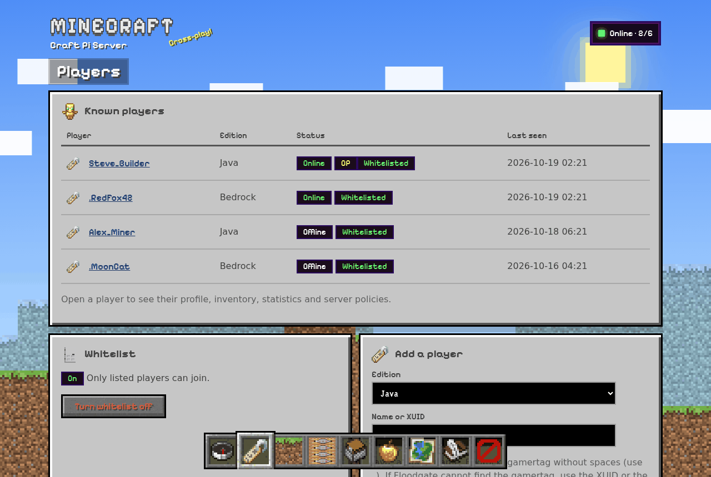

### Perfiles y acciones de jugador

Cada jugador tiene una ficha:
- **Datos:** edición, estado, operador, whitelist, ban, UUID y XUID, primera y última conexión, tiempo jugado.
- **Vitales:** vida, hambre, nivel.
- **Ubicación:** posición actual, cama y última muerte, con enlace al mapa.
- **Inventario:** armadura y cofre de ender, con los iconos reales.
- **Estadísticas y logros.**

Con el jugador conectado, posición y vida se leen en vivo.

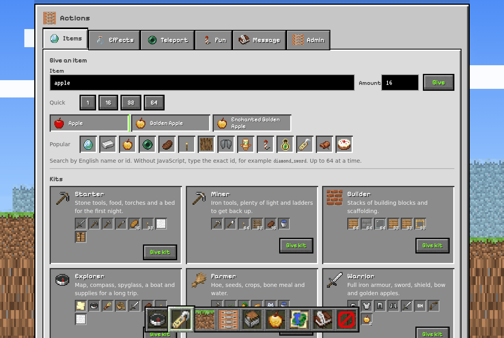

La tarjeta **Actions** agrupa las acciones en pestañas al estilo del inventario creativo:

| Pestaña | Acciones |
| --- | --- |
| Items | Buscar cualquier objeto por su nombre en inglés y darlo (1–64). Kits: Starter, Miner, Builder, Explorer, Farmer y Warrior. Niveles de experiencia y vaciar inventario |
| Effects | 14 efectos (visión nocturna, velocidad, salto, invisibilidad…) de 1, 5 o 15 minutos y nivel I o II; curar, alimentar y quitar efectos |
| Teleport | Al spawn, a su cama, a su última muerte (con 30 s de protección para recuperar sus cosas; nunca al vacío), a otro jugador, traerlo, o a coordenadas (Y vacía = superficie, sólo en el Overworld) |
| Fun | Fuegos artificiales, trueno (sólo sonido y chispas), mascota ya domesticada (lobo, gato o loro) y encantar el objeto de la mano hasta su nivel máximo |
| Message | Chat (`[Server]` en dorado), título grande o texto sobre la barra, hasta 100 caracteres |
| Admin | Operador, whitelist, ban y unban, modo de juego y kick |

Con el jugador desconectado sólo funcionan operador, ban y unban, y quitarlo de la whitelist. Cada acción muestra un aviso sin mover la página y queda registrada en la Pi.

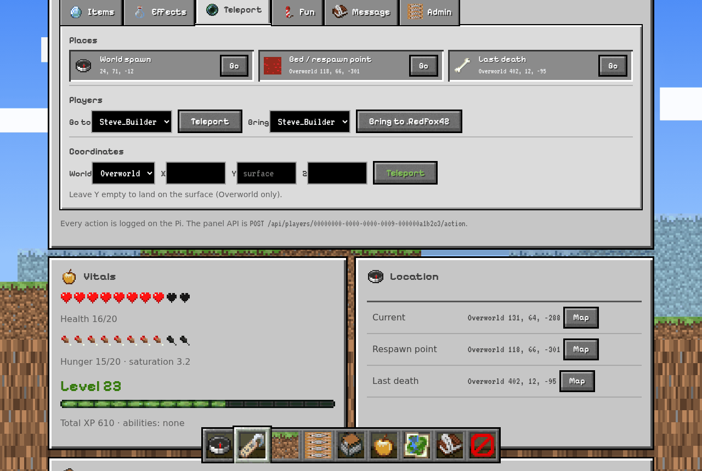

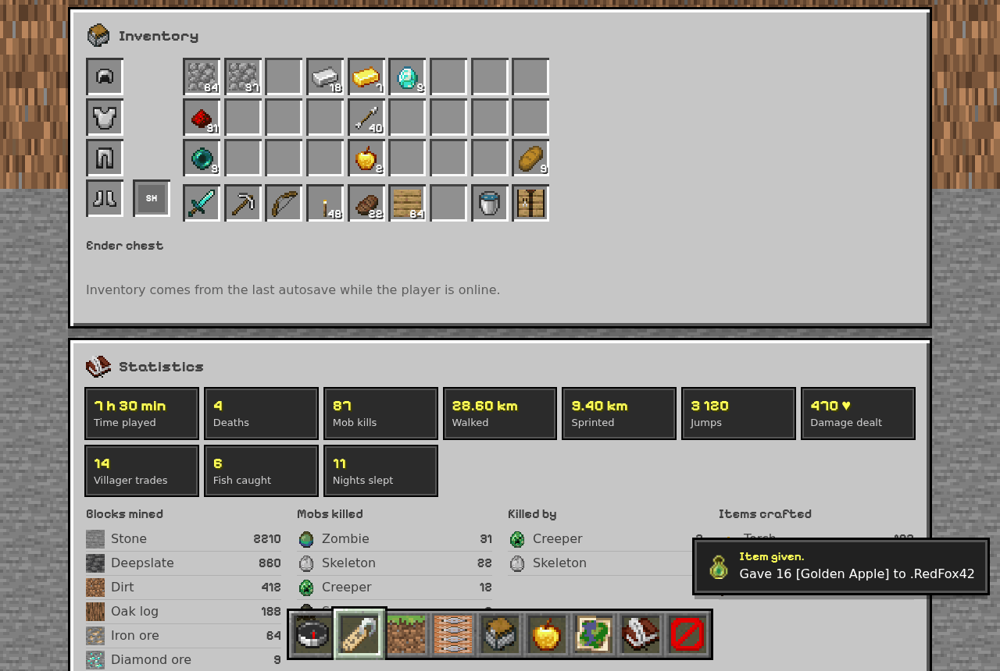

### Tareas largas y avisos

Backups, arranques, cambios de mundo, importaciones y exportaciones corren en segundo plano: aparece un aviso «started» y puedes seguir navegando. La bandeja de la cabecera muestra la tarea en curso. Al terminar sale un aviso «done!» o «failed»; al pulsarlo se abre el resultado.

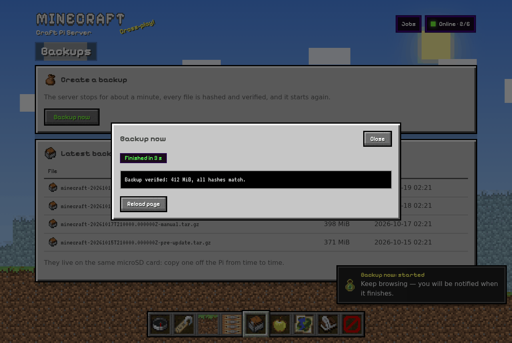

### Consola y auditoría

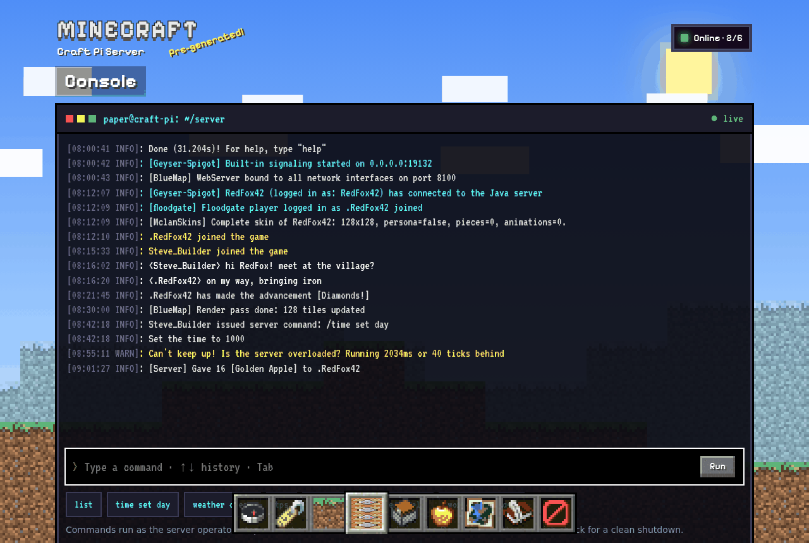

La consola ejecuta comandos de operador (give, tp, time…), igual que `manage.sh command`:
- Una sola línea de hasta 256 caracteres.
- `stop`, `restart` y `reload` están bloqueados; para eso están los botones, que comprueban el cierre limpio.
- Cada comando queda en `logs/operations.log`.

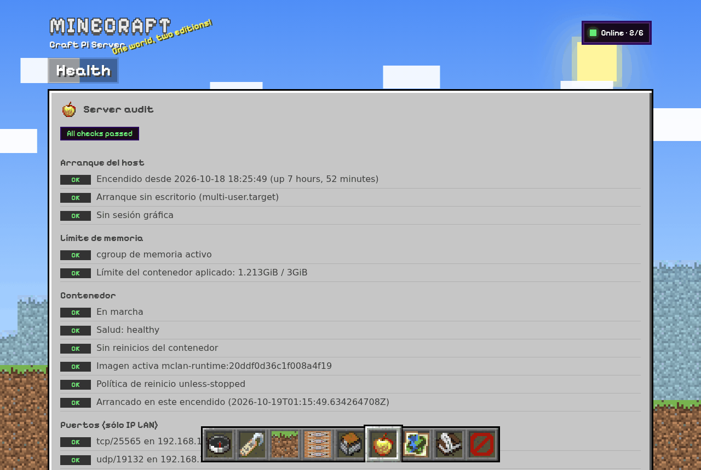

### En el móvil

<p>
  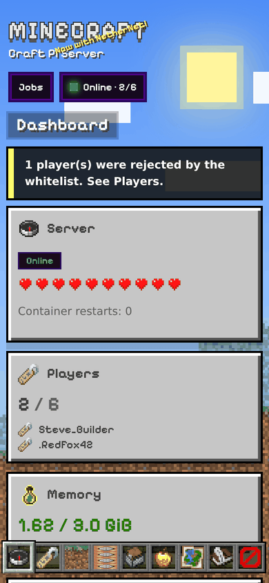
  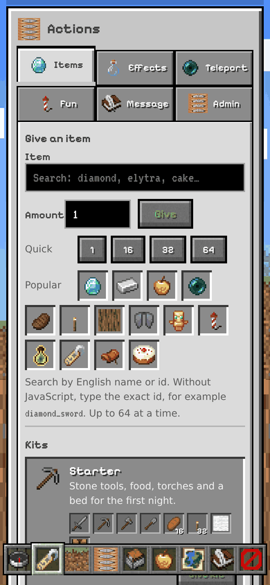
</p>

Probado con emulación real de dispositivo a 320, 360, 390, 412 y 768 px:
- Sin desbordes horizontales.
- Textos de 12 px o más.
- Zonas táctiles de 40 px o más, salvo las casillas de la barra a 320 y 360 px (34 y 39 px). Siguen cumpliendo el mínimo de 24 px de WCAG 2.2.

### API

La interfaz usa una API JSON que también puedes llamar con tu sesión. Los POST exigen el token CSRF en `X-CSRF-Token` y el mismo `Origin`.

| Ruta | Uso |
| --- | --- |
| `GET /api/pulse` | Estado en vivo (salud, jugadores, memoria, temperatura) |
| `GET /api/console?lines=200` · `POST /api/console` | Logs y un comando (`{"command": "time set day"}`) |
| `POST /api/players/<uuid>/action` | Acción de jugador: `{"do": "give", "item": "diamond_sword", "count": 1}`. Acciones y campos en `panel/catalog.py` (`FIELDS`) |
| `GET /api/items` | Catálogo de objetos `[id, nombre, icono]` |
| `GET /api/jobs` · `GET /api/job/<id>` · `POST /api/job/<id>/seen` | Tareas en segundo plano, su resultado y marcarlas como vistas |
| `GET /api/upload-check?name=…&size=…` · `POST /upload` | Comprobar y subir un mundo (cuerpo binario, nombre en `X-Filename`) |

Respuestas:
- **Acciones de jugador:** `{"ok": true, "message", "output"}` o `{"ok": false, "error"}`.
- **`pulse` y `console`:** el resultado del helper (`{"ok", "output", …}`). `lines` admite 100, 200 o 500.
- **`items` y `jobs`:** `{"items": […]}` y `{"jobs": […]}`.
- **Sin sesión, o sin CSRF u `Origin`:** `{"error": …}` con 401 o 403.

### Seguridad del panel

- **Proceso sin privilegios.** El servidor web corre como `mclan-panel` y no habla con Docker. Todo pasa por `panel/helper.py`, lo único que puede ejecutar con sudo, y que sólo acepta verbos fijos con valores validados por patrones y listas cerradas.
- **Nada de texto libre a la consola**, con una excepción: el mensaje a un jugador. Es texto imprimible de hasta 100 caracteres, sin saltos de línea ni códigos de color, y viaja dentro de un componente de texto escapado con `json.dumps`, nunca como parte del comando. Autenticación, puertos y RCON no se pueden cambiar desde la web.
- **Código de root.** `panel/install.sh` exige que el helper, todo el código que importa y `addons/` pertenezcan a root y no tengan escritura de grupo u otros.
- **Configuración de root.** `/etc/mclan-panel` es de root: el panel sólo lee el certificado, su clave y las texturas, y sólo escribe en `/etc/mclan-panel/data/` (`panel.json` al cambiar la contraseña). Root nunca abre nada de esa carpeta por su ruta (`panel/install_config.py`: descriptores de directorio, `O_NOFOLLOW` y temporales con `O_EXCL`), así que un panel comprometido no puede redirigir con un enlace lo que haga `sudo panel/install.sh`.
- **Contraseña y sesión:**
  - contraseña con PBKDF2-SHA256 y bloqueo tras 5 fallos en 10 minutos;
  - cookie `__Host-` con `Secure`, `HttpOnly` y `SameSite=Strict`;
  - token CSRF y comprobación de `Origin` en cada POST.
- **Protección de las peticiones:**
  - CSP sin código ni estilos en línea;
  - sólo se atiende su propio `Host`, contra el DNS rebinding;
  - límites de conexiones (32 en total, 8 por IP) y de tamaño de petición.
- **Acceso a `data/`.** El helper no sigue enlaces, lee archivos con tope de tamaño y escribe `server.properties` mediante descriptores de directorio. Las operaciones usan el mismo bloqueo que `manage.sh` y quedan en `logs/operations.log`.
- **Reinicios seguros.** Reiniciar el panel no corta un backup o un reinicio en curso (`KillMode=process`).

**Texturas.** `panel/install.sh` extrae dentro del contenedor, del cliente que descargó BlueMap, una lista cerrada de texturas y el catálogo de objetos (`items/` y `lang/en_us.json`). Lo hace con `panel/extract_assets.py`; después `panel/install_assets.py` lo valida en el host: nombres permitidos, firma PNG, tamaños y JSON. Se sirve sólo en la LAN. Las fuentes Pixelify Sans y VT323 son OFL y están en `panel/static/fonts/`.

```bash
sudo panel/install.sh                   # instalar o actualizar (repetir tras rebind o git pull)
sudo panel/install.sh --reset-password  # nueva contraseña desde la terminal
sudo panel/install.sh --uninstall       # retira servicio y regla sudo; conserva /etc/mclan-panel
```

## 6. Mapa BlueMap

Mapa 3D con los jugadores en vivo en `http://IP_DE_LA_PI:8100/`, sólo en la LAN. [BlueMap](https://bluemap.bluecolored.de/) es un plugin de Paper dentro del mismo proceso, resuelto en Hangar y fijado por SHA-256 como el resto.

- **Configuración inicial:** `plugins/BlueMap/core.conf` se crea una vez con `accept-download: true`, que acepta la EULA ya aceptada en `eula.txt` para descargar las texturas de Mojang. Lleva además dos hilos de render y métricas desactivadas. Tus cambios posteriores se respetan.
- **Ajuste de la web (`craft-pi: tuning-1`):** 250 bloques de detalle cercano y 4000 de vista lejana. Si el navegador conserva los valores anteriores, usa *Settings → Reset* en BlueMap.
- **Paper 26.x y la luz:** Moonrise no deja la luz como la espera BlueMap, y sin ajuste el mapa se ve negro de cerca. `docker/bluemap-setup.sh` activa `ignore-missing-light-data` una vez por mapa (`craft-pi: light-fix`).
- **Backups:** no incluyen las teselas (`data/bluemap/web/maps`); se regeneran.
- **Mapa negro al abrirlo:** el navegador puede haber guardado una posición sin terreno. Usa **Live map** en el panel, que centra en el spawn.

Para ahorrar recursos, desde **World** en el panel o desde la terminal:

```bash
sudo ./manage.sh command "bluemap stop"   # pausa el render; la web sigue
sudo ./manage.sh command "bluemap start"
sudo ./manage.sh plugin bluemap off       # retira el plugin y su memoria (reinicia)
sudo ./manage.sh plugin bluemap on
```

## 7. Biblioteca de mundos

Hasta **50 mundos** guardados y **uno activo**, siempre en los puertos de siempre: nadie cambia de dirección. Desde **World → World library** o la terminal:

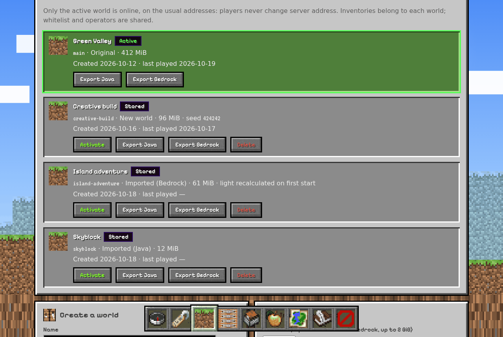

```bash
sudo ./manage.sh world list
sudo ./manage.sh world create "Creative build" --seed 424242
sudo ./manage.sh world import imports/mundo.zip "Mi mundo Java"
sudo ./manage.sh world import imports/mundo.mcworld "Mi mundo Bedrock"
sudo ./manage.sh world activate creative-build     # pide CAMBIAR
sudo ./manage.sh world export main --format java   # o --format bedrock → exports/
sudo ./manage.sh world rename skyblock "Skyblock 2"
sudo ./manage.sh world delete skyblock             # lo archiva en backups/worlds y lo borra
```

- **Dónde está cada cosa:** el mundo activo vive en `data/world`. Los demás, en `worlds/<id>/world`, con su mapa en `worlds/<id>/bluemap-maps`.
- **Qué guarda cada mundo:** inventarios y datos de jugador, borde, spawn y ajustes (dificultad, modo, PvP, vuelo, protección del spawn, semilla). Whitelist, operadores y bans son comunes a todos.
- **Activar** sigue estos pasos:
  1. Para el servidor y hace un backup verificado `pre-switch-<id>`.
  2. Intercambia mundo, mapa y ajustes, y verifica.
  3. Si el mundo nuevo no arranca, deshace el cambio y arranca el anterior.

  Un mundo nuevo se genera con su semilla. Uno Bedrock importado recalcula su luz la primera vez.
- **Importar:** sube el `.zip` (Java) o `.mcworld` (Bedrock) desde el panel, hasta 2 GiB con barra de progreso, o cópialo a `imports/`.
  - La extracción rechaza rutas, enlaces y tamaños anómalos, y también mundos más nuevos que el servidor.
  - Bedrock se convierte con [Chunker](https://github.com/HiveGamesOSS/Chunker) 1.21.0, fijado por SHA-256, en un contenedor sin red. Se pierden animales, monstruos, objetos en el suelo, barcas y vagonetas con cofre.
- **Exportar:** genera un zip Java o un `.mcworld` en `exports/` con su `.sha256`, descargable desde el panel.
- **Backups y restore:** los backups normales sólo incluyen el mundo activo. `restore` sabe de qué mundo es cada backup. Si es de otro, guarda el activo en la biblioteca y aparta la copia anterior del mundo entrante en `state/pre-restore-world-*`: no se pierde nada.

La migración manual de un mundo Bedrock, tal como se ensayó antes de existir la biblioteca, sigue documentada en [ESTADO.md](docs/ESTADO.md). `tools/relight.py` recalcula la luz de un mundo convertido.

## 8. Skins de Bedrock (MclanSkins)

Sin ayuda, las skins Bedrock salen mal:
- Floodgate da a cada jugador Bedrock la conversión Java de su skin (64×64, cuerpo estándar), y Geyser manda esa misma conversión a los clientes Bedrock.
- Las skins con forma propia salen aplanadas.
- Las del creador de personajes (persona: piezas, tintes y cara animada) las rechaza el cliente y muestra una skin por defecto.

El addon propio **MclanSkins** (`addons/mclan-skins`) lo corrige:

- **Jugadores Bedrock:** ven las skins Bedrock **completas**, también la propia. Al iniciar sesión, el addon guarda la skin que firmó el cliente y la pone en cada entrada de la lista de jugadores que Geyser envía a Bedrock, como hace el servidor oficial de Bedrock.
- **Jugadores Java:** ven la skin por defecto (Steve/Alex). Con `java-skin: converted` en `data/plugins/MclanSkins/config.yml` (y reinicio) ven la conversión de GeyserMC.
- **Cambiar de skin:** se aplica al volver a conectar. Geyser no traslada el cambio en mitad de la partida.
- **Compilación:** se compila en la Pi durante la instalación y cada `update`.
  - Lo hace en un contenedor JDK fijado por digest, sin red, contra los JAR exactos de la release.
  - Si Geyser cambia algo incompatible, `update` falla **antes** de parar el servidor y dice cómo seguir.
- **Desactivarlo:** `sudo ./manage.sh plugin mclan_skins off`, o `install.sh --disable-plugin mclan_skins` en la primera instalación. Desactivado, no se compila ni necesita el JDK, así que nunca bloquea una actualización. Al reactivarlo (`plugin mclan_skins on`), el siguiente `update` lo compila. `tools/audit.sh` avisa si el addon no puede engancharse a la build de Geyser.
- **Límites:** el addon sólo reenvía skins razonables (hasta 512×512, 8 animaciones, 64 piezas, 16 tintes y 1 MiB de geometría). Si una skin se sale, ese jugador se ve con la skin que construye Geyser.

## 9. Administración desde la terminal

Desde `/opt/minecraft-lan-installer`. `sudo` es intencionado: pertenecer al grupo docker equivale a ser root.

| Comando | Resultado |
| --- | --- |
| `sudo ./manage.sh start` · `stop` · `restart` | Arranca y verifica, o para con hasta 180 s para un cierre limpio |
| `sudo ./manage.sh status` | Estado del contenedor y de la release activa |
| `sudo ./manage.sh logs --tail 150` · `--follow` | Logs del servidor (Ctrl+C no para el servidor) |
| `sudo ./manage.sh verify` | Verificación completa de servicios y protocolos |
| `sudo ./manage.sh backup` · `restore ARCHIVO` | Backup verificado y restauración ([§10](#10-backups-y-restauración)) |
| `sudo ./manage.sh update --plan` · `update` | Ver y aplicar versiones nuevas ([§11](#11-actualizar)) |
| `sudo ./manage.sh rebind 192.168.1.60` | Cambiar la IP publicada si cambia el DHCP; después `sudo panel/install.sh` |
| `sudo ./manage.sh plugin bluemap\|mclan_skins on\|off` | Activar o desactivar un plugin opcional (reinicia si estaba en marcha) |
| `sudo ./manage.sh world …` | Biblioteca de mundos ([§7](#7-biblioteca-de-mundos)) |
| `sudo ./manage.sh command "list"` | Comando de consola tras confirmar `EJECUTAR` |
| `sudo tools/audit.sh [--verify]` | Auditoría de sólo lectura |

Sólo una operación que cambie el estado puede correr a la vez; `status` y `logs` siguen disponibles. Los comandos de consola tienen permisos de operador: no pongas contraseñas en ellos.

## 10. Backups y restauración

```bash
sudo ./manage.sh backup
sudo ./manage.sh restore backups/minecraft-FECHA-manual.tar.gz   # pide RESTAURAR
```

**Qué hace `backup`.** Para el servidor si estaba en marcha, espera un cierre limpio, crea el archivo y lo vuelve a leer comprobando **todos los hashes**. Después arranca sólo si estaba funcionando.

La copia sólo se da por consistente si los logs prueban que el mundo se guardó. Vale el mensaje vanilla `All dimensions are saved` o, en Paper 26.x, la secuencia `Saving worlds` → `Halted I/O scheduler for world` → `All RegionFile I/O tasks to complete`. Un OOM, un SIGKILL o la falta de esa prueba impiden darla por buena.

**Qué contiene.** El mundo activo, los jugadores, la configuración, la EULA, los datos y claves de plugins, los metadatos, `compose.yaml`, `.env` y los JARs de la release activa. Lleva un `.sha256` y un manifiesto interno.

**Las copias contienen la clave de Floodgate y la contraseña de RCON**: no las subas a ningún repositorio.

**Qué hace `restore`.**
- Valida en una carpeta temporal y rechaza rutas absolutas, `..`, enlaces, dispositivos, duplicados y archivos que no estén en el manifiesto.
- Comprueba los JARs antes de tocar el mundo.
- Guarda una copia `pre-restore` o, si el estado actual no es consistente, aparta íntegro el directorio en `state/pre-restore-…`.
- Una operación interrumpida deja `state/operation.json` y bloquea los arranques hasta resolverla.
- Si una actualización ya abrió el mundo, se restaura **el snapshot completo**: no existe un downgrade seguro de mundos.
- En otro equipo: `restore ARCHIVO --lan-ip NUEVA_IP`.

Guarda de vez en cuando una copia **fuera de la microSD**: si la tarjeta falla, se pierden también los backups que haya en ella. No hay backups programados ni purga automática: los `pre-switch` y `pre-update` se acumulan y conviene borrar los antiguos a mano. Más detalle en [RECUPERACION.md](docs/RECUPERACION.md).

## 11. Actualizar

### Versiones de Minecraft y plugins

```bash
sudo ./manage.sh update --plan    # muestra las builds propuestas y los cambios del proyecto
sudo ./manage.sh update           # pide ACTUALIZAR
```

- **Qué propone:** builds compatibles con la misma versión de Minecraft del mundo. Si Geyser ya exige otra versión de Java, `update` se detiene; para subir de versión de Minecraft, hazlo de forma explícita con `--minecraft-version auto`.
- **Antes de parar el servidor:** descarga, construye y compila todo.
- **Después:** crea el snapshot `pre-update`, activa la release nueva y verifica.
- **Si la verificación falla:** detiene la release nueva, conserva la marca de operación y te indica el snapshot que debes restaurar.
- **Plugins desactivados:** siguen desactivados después de actualizar.

### Código de este proyecto

`manage.sh update` no descarga cambios del repositorio; eso se hace con Git:

```bash
cd /opt/minecraft-lan-installer
sudo ./manage.sh backup
sudo git pull --ff-only
sudo ./manage.sh update --plan    # avisa si hay código Docker, Compose o addons nuevos
sudo ./manage.sh update           # reconstruye, hace snapshot, aplica y verifica
sudo panel/install.sh             # aplica el código nuevo del panel y renueva texturas y catálogo
sudo tools/audit.sh
```

Tras un `git pull` con código Docker o Compose nuevo, `start` y `restart` se niegan a arrancar hasta ejecutar `update`; `status`, `logs` y `stop` siguen disponibles.

`compose.yaml` sólo se sustituye si es idéntico a una plantilla publicada (`PREVIOUS_TEMPLATES` en `scripts/mclan/runtime.py`). Si lo editaste a mano, todas las operaciones (`status`, `start`, `update`, `restore`…) se detienen sin tocarlo hasta que vuelva a coincidir con la plantilla.

`manage.sh` no actualiza Raspberry Pi OS ni Docker Engine.

## 12. Configuración y memoria

| Parámetro | Inicial | Motivo |
| --- | --- | --- |
| JVM `-Xms` / `-Xmx` | 512 MiB / 2048 MiB | Deja sitio a la memoria nativa, Geyser y el sistema |
| Límite del contenedor | 3 GiB, sin swap extra | **Sólo con el cgroup de memoria activo** ([§3.1](#31-ajustes-recomendados-del-sistema)) |
| View / simulation distance | 6 / 4 chunks | Punto de partida moderado para la Pi |
| Max players | 6 | Límite inicial, no una garantía de rendimiento |

Es una configuración de partida conservadora, no un benchmark: prueba con 2–4 jugadores y vigila CPU, temperatura y memoria (Dashboard o Health).

Dificultad, MOTD, distancias, PvP y otros ajustes se cambian en **World → Server settings** (guardar reinicia). A mano: `stop`, edita `data/server.properties` y `start`. Conserva estos valores, que el validador exige:
- `online-mode=true`;
- `enforce-secure-profile=false` (permite el juego cruzado sin pedir a Bedrock un perfil firmado de Java; no desactiva la autenticación);
- `enable-status=true`;
- RCON interno y los puertos previstos.

**Si activaste el cgroup de memoria después de instalar**, recrea el contenedor una vez: el que ya existía conserva `Memory=0` aunque reinicies. Los datos no se tocan:

```bash
sudo ./manage.sh stop
sudo docker compose --project-name minecraft-lan rm -f minecraft
sudo ./manage.sh start
```

**Plugins gestionados.** En cada arranque, el entrypoint sincroniza desde la release fijada `Geyser-Spigot.jar`, `floodgate-spigot.jar`, `BlueMap.jar`, `Chunky.jar`, `ViaVersion.jar`, `ViaBackwards.jar` y `MclanSkins.jar`. No pongas otras copias de esos plugins con otro nombre en `data/plugins/`.

**Archivos gestionados.** `compose.yaml` es copia de `docker/compose.template.yaml` y el validador rechaza divergencias. `.env` se genera a partir del estado: para cambiar la IP usa `rebind`.

## 13. Red y arranque automático

- **Puertos:** se publican sólo en la IPv4 LAN elegida: TCP 25565 (Java), UDP 19132 y TCP 19132 (Bedrock y signaling NetherNet), UDP 19133 (WebRTC) y TCP 8100 (mapa). El panel escucha en TCP 8443 de esa misma IP.
- **RCON:** 25575 no se publica nunca fuera del contenedor.
- **Router y firewall:** no se toca el router (ni port forwarding ni UPnP) ni las reglas del firewall del host. Docker sí gestiona sus propias reglas para publicar puertos, y eso puede interactuar con UFW o firewalld. Publicar en una IP local no es una ACL: equipos de otras subredes que ya lleguen a esa IP podrían acceder.
- **Si cambia la IP por DHCP:** `sudo ./manage.sh rebind NUEVA_IP` y después `sudo panel/install.sh`, que renueva el certificado.
- **Al arrancar la Pi:** Docker y el panel arrancan con systemd, y el contenedor usa `restart: unless-stopped`. Una parada manual se respeta incluso tras reiniciar; vuelve con `manage.sh start`.

## 14. Diagnóstico

| Síntoma | Qué hacer |
| --- | --- |
| `You are not whitelisted` | Añádelo en Players, o usa **Open 5 min and wait** en su intento rechazado (Bedrock) |
| Floodgate «does not know» un gamertag | Usa su XUID o la apertura temporal ([§3.5](#35-primer-acceso-whitelist-y-operador)) |
| Java entra y Bedrock no | Versión Bedrock dentro del rango de Geyser, UDP 19132 y 19133, aislamiento de la Wi-Fi y que el cliente permita añadir servidores |
| Java de otra versión sale en rojo | Demasiado antigua para ViaBackwards (anterior a la 1.10) |
| Skin Bedrock por defecto o aplanada | `tools/audit.sh`: MclanSkins debe estar habilitado y enganchado. Reconecta tras cambiar de skin |
| Panel sin iconos ni buscador de objetos | Repite `sudo panel/install.sh` con el servidor en marcha y BlueMap activo |
| El panel no carga | `sudo systemctl status mclan-panel` y `sudo journalctl -u mclan-panel -n 50`; usa `https://` y el puerto 8443 |
| `install` o `update` falla al compilar MclanSkins | La build nueva de Geyser cambió algo interno. En la primera instalación repite con `--disable-plugin mclan_skins`; si ya está instalado, `sudo ./manage.sh plugin mclan_skins off` y repite `update` |
| `start` pide ejecutar `update` | Hiciste `git pull` con código Docker o Compose nuevo ([§11](#11-actualizar)) |
| Mapa negro | Usa Live map desde el panel; tras importar un Bedrock, `bluemap purge MAPA` |
| Límite de memoria no efectivo | Activa el cgroup ([§3.1](#31-ajustes-recomendados-del-sistema)) y recrea el contenedor ([§12](#12-configuración-y-memoria)) |
| Varias IP candidatas al instalar | `ip -4 addr` y `--lan-ip` |
| Puerto ocupado | `sudo ss -ltnup`: algo usa 25565, 19132, 19133, 8100 u 8443 |
| ARM64 rechazado | `uname -m` y `dpkg --print-architecture`: hace falta el sistema de 64 bits |
| Fallo HTTP, DNS o TLS | Fecha y hora (`timedatectl`), DNS y proxy; no desactives TLS |
| Falta un build estable compatible | Espera a que Paper o Geyser lo publiquen; el proyecto no fuerza versiones |
| OOM o reinicios | `sudo docker stats --no-stream`; baja distancias o pausa BlueMap |
| Backup sin confirmar el guardado | Revisa el log del cierre; no fuerces la copia como consistente |
| Operación interrumpida | Sigue [RECUPERACION.md](docs/RECUPERACION.md) con el snapshot de `state/operation.json` |

```bash
sudo ./manage.sh status
sudo ./manage.sh logs --tail 200
sudo tools/audit.sh
sudo docker stats --no-stream
free -m; df -h; vcgencmd measure_temp; vcgencmd get_throttled
```

Los logs de operaciones rotan en `logs/`. Docker guarda tres archivos de unos 10 MB, y Paper escribe además en `data/logs/`, que no se purga.

## 15. Arquitectura, archivos y desarrollo

Un único contenedor ejecuta **Paper** con todos los plugins en la misma JVM. El panel es un servicio aparte del host.

| Tráfico o dato | Recorrido |
| --- | --- |
| Java | IP LAN, TCP 25565 → Paper |
| Bedrock hasta 26.5x (RakNet) | IP LAN, UDP 19132 → Geyser → Paper, autenticado por Floodgate |
| Bedrock 26.60+ (NetherNet) | Signaling TCP 19132 y WebRTC UDP 19133 → Geyser → Paper |
| Panel web | Navegador → `mclan-panel` (TCP 8443) → sudo → `panel/helper.py` → `manage.sh` / RCON interno |
| Mundos | `data/` del host → `/data` del contenedor; mundos guardados en `worlds/` |
| Binarios fijados | `releases/<id>/` → `/opt/release` en sólo lectura |

```text
minecraft-lan-installer/
  install.sh, manage.sh          Entradas Bash pequeñas; la lógica es Python de biblioteca estándar
  scripts/mclan/                 Host, versiones, runtime, backups, mundos, addons, CLI
  docker/                        Dockerfile (Temurin JRE ARM64), plantilla Compose, entrypoint, sondas, BlueMap
  addons/mclan-skins/            Plugin propio de skins (se compila en la Pi)
  panel/                         Servidor web, vistas, helper privilegiado, catálogo de acciones, instalador
  tools/                         audit.sh (auditoría) y relight.py (luz de mundos convertidos)
  docs/                          Estado, guía desde cero, recuperación, validación e imágenes
  tests/                         Pruebas unittest y fixtures de las APIs
  MANIFEST.sha256                SHA-256 de cada archivo del repositorio
```

Al instalar se crean `compose.yaml`, `.env`, `config/settings.json`, `state/`, `releases/`, `data/`, `backups/`, `logs/`, `worlds/`, `imports/` y `exports/`. Ninguno va a Git. No muevas la carpeta con el servidor en marcha.

**Selección de versiones:**
1. La versión de Java la marca la [página oficial de compatibilidad de Geyser](https://geysermc.org/wiki/geyser/supported-versions/).
2. Paper se toma de su build `STABLE` para esa versión.
3. BlueMap, Chunky, ViaVersion y ViaBackwards, de la última *Release* de Hangar que declara esa versión exacta.
4. Todo se fija con el SHA-256 publicado.
5. La imagen usa Temurin con el digest fijado.
6. El esquema de configuración de Geyser se lee del JAR sin ejecutarlo.

Todo queda en `state/active.json` y `releases/<id>/versions.lock.json`. Repetir `install.sh` sobre una instalación activa no cambia versiones ni configuración: sólo comprueba y arranca.

**Pruebas:**

```bash
./tests/run.sh            # sintaxis Bash, compilación Python y unittest
./tests/run.sh --strict   # además ShellCheck (sudo apt-get install shellcheck)
```

No instalan Docker ni APT. Usan temporales, fixtures y dobles de Docker; las sondas se prueban contra sockets reales locales.

Si cambias un archivo, regenera el manifiesto con `git ls-files | grep -v '^MANIFEST.sha256$' | xargs sha256sum > MANIFEST.sha256`.

## 16. Fuentes y licencias

- [Docker en Debian](https://docs.docker.com/engine/install/debian/), [Compose](https://docs.docker.com/compose/install/linux/) y [Docker y firewalls](https://docs.docker.com/engine/network/packet-filtering-firewalls/).
- [API de descargas de Paper](https://docs.papermc.io/misc/downloads-service/) y [requisitos de Java](https://docs.papermc.io/misc/java-install/).
- [Geyser](https://geysermc.org/wiki/geyser/setup/), [compatibilidad](https://geysermc.org/wiki/geyser/supported-versions/), [NetherNet](https://geysermc.org/blog/preparing-for-nethernet), [Floodgate](https://geysermc.org/wiki/floodgate/) y [código fuente](https://github.com/GeyserMC/Geyser).
- [ViaVersion](https://hangar.papermc.io/ViaVersion/ViaVersion), [ViaBackwards](https://hangar.papermc.io/ViaVersion/ViaBackwards), [BlueMap](https://bluemap.bluecolored.de/), [Chunky](https://hangar.papermc.io/pop4959/Chunky) y [Chunker](https://github.com/HiveGamesOSS/Chunker).
- [Raspberry Pi Imager](https://www.raspberrypi.com/software/) y [EULA de Minecraft](https://www.minecraft.net/eula).

Este repositorio no redistribuye JARs, texturas, mundos, claves ni imágenes Docker: todo se descarga de sus proveedores en tu Pi, y cada componente conserva su licencia. Minecraft es una marca de Mojang/Microsoft; este proyecto no está afiliado a ellas.
